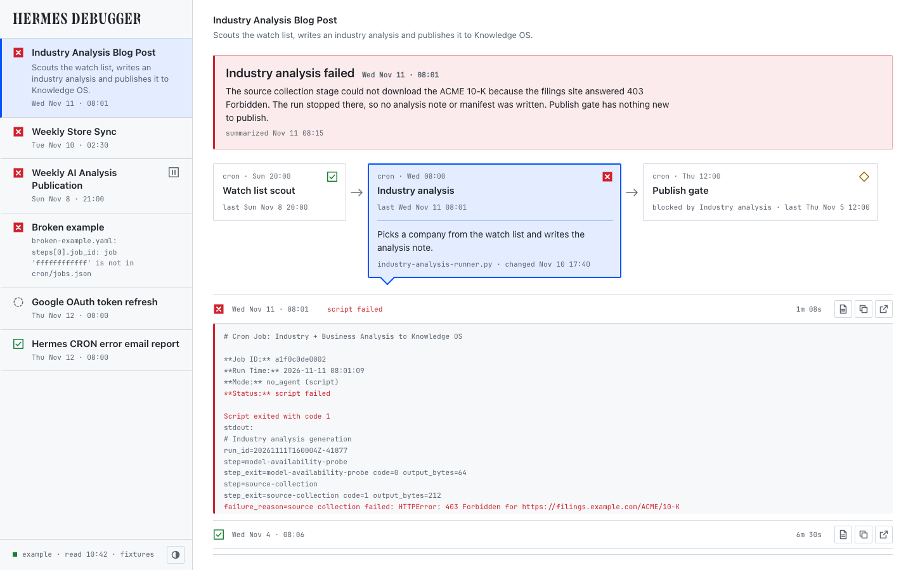

# Hermes Workflow Debugger

A local, read-only dashboard that shows which of your Hermes CRON workflows is failing, at which step, and why.



## Why

I run a handful of Hermes automations on CRON, and several are chains: one job scouts, the next writes, a third publishes. When one breaks, I find out days later because a post never appeared. Then I dig through job lists and output folders to work out which job stopped, whether the ones after it ran anyway, and what the error meant. Hermes knows about jobs, but it has no idea that three of them are one workflow.

## What

You describe each workflow once, in a small YAML file: which CRON jobs are its steps and which step depends on which. The dashboard reads those files and Hermes's own run records, then shows every workflow with the broken ones first. For a failed step you get a two or three sentence summary of the error, written when the failure happened, with the raw output one click away.

## Capabilities

- Workflows listed worst first: failed, missed, blocked, ok. Paused is shown separately and never counts as a problem.
- Steps drawn in dependency order. A step is blocked when a step above it failed and it has not run since.
- A short summary per failed step, written by a background Hermes session at failure time, not when you open the page.
- Every run of a step, with its raw output file and the failure lines in red.
- The workflow files double as a Hermes skill, so any session can answer "what does this step depend on?"
- Read-only. The server answers GET requests on 127.0.0.1 and never writes to your Hermes profile.
- Fixture mode with made-up data, so you can try it without a Hermes install.
- What it does not do: suggest a workflow file for you, suggest a fix, show model or tool calls, send notifications, or edit anything.

## Getting started

Needs Python 3.11 or newer. Tested on macOS.

```bash
git clone https://github.com/patrickluvsoj/hermes-workflow-debugger.git
cd hermes-workflow-debugger
python3.11 -m venv .venv
.venv/bin/pip install -e .
.venv/bin/wfd serve --fixtures
```

Open http://127.0.0.1:8787. The rail footer reads "fixtures".

Against a real Hermes profile, after you have added a workflow file (next section):

```bash
.venv/bin/wfd serve
```

It reads `~/.hermes/profiles/daily` by default. Use `--profile-root` for another profile, `--scaffolds` for another workflow folder and `--port` for another port. `wfd status` prints the same information in the terminal.

## Set up a scaffold file

One YAML file per workflow, in the `workflow-scaffolds` skill of your profile:

```
~/.hermes/profiles/daily/skills/devops/workflow-scaffolds/workflows/weekly-report.yaml
```

Copy `examples/SKILL.md` into `workflow-scaffolds/` as well if you want Hermes sessions to be able to load the files as a skill.

```yaml
id: weekly-report
title: Weekly Report
description: Drafts a weekly report and publishes it.
steps:
  - id: draft
    title: Draft
    description: Gathers the week's notes and writes the report.
    job_id: 0123456789ab
    depends_on: []
  - id: publish
    title: Publish
    description: Publishes the report if the draft succeeded.
    job_id: ba9876543210
    depends_on: [draft]
```

| Field | Required | Meaning |
|---|---|---|
| `id` | yes | Short name for the workflow. Unique across files |
| `title` | yes | Name shown in the dashboard |
| `description` | yes | One sentence on what the workflow does |
| `steps` | yes | List of steps, at least one |
| `steps[].id` | yes | Short name for the step. Unique inside the file |
| `steps[].title` | yes | Name shown in the step box |
| `steps[].description` | no | One sentence on what the step does |
| `steps[].job_id` | yes | ID of the CRON job that runs this step. Each job can be used once per file |
| `steps[].depends_on` | no | List of step `id`s that must have succeeded first. Leave empty for a first step |
| `steps[].expect` | no | What the step is expected to produce. See the next section |

- Find a job's ID with `hermes cron list`.
- A dependency names another step's `id`, not its job ID. A step with two entries in `depends_on` waits on both.
- Check the file with `.venv/bin/wfd status`. It prints each workflow and step, and exits with code 1 if a file is not valid.
- A file with a mistake is not skipped. It appears in the dashboard as failed, with the field at fault, for example `steps[1].job_id: job 'ba9876543210' is not in cron/jobs.json`.

## Say what a step should produce (optional)

A CRON can exit cleanly and still do nothing: a publish step that finds nothing to publish, for example. The dashboard calls that a no-op and shows it with its own glyph, between blocked and ok. The script reports what happened. The scaffold says what was expected.

**In the script**, print one line per run:

```
step_result={"schema": 1, "outcome": "noop", "reason": "quality_gate_not_met", "detail": "The draft scored 61 of 100. The gate needs 75."}
```

| Field | Required | Meaning |
|---|---|---|
| `schema` | yes | `1` |
| `outcome` | yes | `done`: the step did its job. `noop`: it ran correctly and chose to do nothing. `failed`: it could not do its job |
| `reason` | for `noop` and `failed` | A short fixed code. The same cause gets the same code on every run |
| `detail` | no | One plain sentence: which check was not met, with numbers. No secrets |

- The dashboard shows `reason` and `detail` on the trace row as written.
- If a run prints the line more than once, the last one counts. A line that is not valid is ignored.
- A script that prints `failed` should also exit non-zero, so Hermes records the failure.
- Hermes's own status comes first. A run Hermes marks `script failed` is failed whatever the line says.

**In the scaffold**, add `expect` to a step:

```yaml
  - id: publish
    title: Publish
    job_id: ba9876543210
    depends_on: [draft]
    expect:
      allow_silent: false
      noop: flag
      noop_when: ['^nothing to publish']
      success_when: '^published='
```

| Field | Default | Meaning |
|---|---|---|
| `allow_silent` | `false` | `true`: a run that prints nothing (`silent (empty output)`) is ok. Otherwise it is failed |
| `noop` | `flag` | `flag`: a no-op run is shown as no-op. `ok`: it is shown as ok, for a step that is often idle |
| `noop_when` | none | List of regular expressions. A match anywhere in the output means no-op |
| `success_when` | none | One regular expression. If it matches nothing in the output, the run is a no-op |

- `noop_when` and `success_when` are for scripts that do not print a `step_result` line. A run that prints the line ignores them.
- Patterns are matched per line (`^` is the start of a line). They copy the script's wording, so update them when the script changes.
- A step with no `expect` block behaves as before: silent is failed, and anything that exits cleanly is ok.
- A no-op step does not block the steps after it.

## Error summaries (optional)

Without this, a failed step shows the first error line of its output. To get written summaries, run the watcher on a schedule. Each pass looks for new failures and asks a one-shot Hermes session, with no tools, on your default model, for a summary. A pass with nothing new makes no model call.

```bash
cp examples/workflow-debugger-watcher.py ~/.hermes/profiles/daily/scripts/
hermes cron create "5m" --no-agent --script workflow-debugger-watcher.py --name "Workflow debugger watcher" --deliver local --failure-deliver local
```

If the checkout is not in `~/Code/hermes-workflow-debugger`, set `WFD_REPO` in the script. To stop it: `hermes cron pause <job id>`, or `hermes cron remove <job id>` to delete it.

## Known limits

- A `step_result` line is the script's own claim. A script that prints `done` and produced bad output is shown as ok. The debugger does not check that a file or a commit exists.
- A step with no `expect` block and no `step_result` line is ok whenever it exits cleanly, even if it did nothing. A run that prints nothing is failed unless the step sets `allow_silent`.
- Missed runs in the past are found only for jobs on a cron expression, and only as far back as Hermes keeps execution records (about ten days).
- Workflows that branch are drawn as a single row of steps.

## Status

A prototype, built for one person's Hermes setup and tested against one Hermes version. Expect rough edges.

MIT licence, see `LICENSE`. The bundled JetBrains Mono font has its own licence, see `web/fonts/README.md`.
